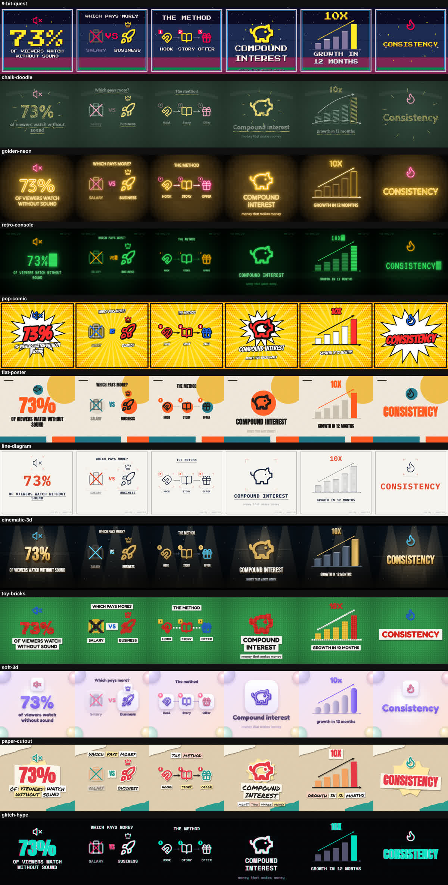

# Animated B-roll for the clipping studio

Paste a link → turn on **Animated B-roll** → pick a style → every generated talking-head clip gets short animated explainers (stats, comparisons, steps, trends, key ideas) at the moments that need them, with an entry sound effect, in the chosen style.



## Styles

| id | name | look |
|---|---|---|
| `9-bit-quest` | 9-Bit Quest | retro RPG pixels, 16-colour palette, dissolve, chip SFX |
| `chalk-doodle` | Chalk Doodle | chalk on slate, hand-drawn reveal, doodled underlines |
| `golden-neon` | Golden Neon | flickering gold neon tubes on a dark brick wall, buzz SFX |
| `retro-console` | Retro Console | green CRT terminal, typing cursor, scanlines, power-on |
| `pop-comic` | Pop Comic | POW starburst, halftone, ink outlines, slam + shake |
| `flat-poster` | Flat Poster | flat colour blocks, bold condensed type, colour wipe |
| `line-diagram` | Line Diagram | technical line art, callout brackets, hatching, typed labels |
| `cinematic-3d` | Cinematic 3D | extruded gold type, light beams, dust, slow push-in |
| `toy-bricks` | Toy Bricks | icons and numbers build themselves from studded bricks |
| `soft-3d` | Soft 3D | pastel clay icons on pillow cards, elastic bounces |
| `paper-cutout` *(bonus)* | Paper Cutout | stop-motion paper scraps on kraft, 12 fps boil |
| `glitch-hype` *(bonus)* | Glitch Hype | RGB split, slice glitches, scrambled text |

Scene types (chosen per moment): `stat` (number counts up), `compare` (A vs B, winner crowned), `steps` (2–4 steps), `trend` (bars + arrow up/down), `concept` (icon + idea), `keyword` (punch word).
Layouts: `split` (B-roll top half, speaker re-framed into the bottom half), `full` (full-screen cutaway), `pip` (rounded card over the speaker).
Text works in Arabic (RTL, Cairo font), French and English. 1,500+ icons (Lucide).

## How it works

```
clip.mp4 + word timings
   │
   ├─ planner.py   Claude reads the timed transcript → cues {start, end, template, text, icons}
   │               (rule-based fallback offline: numbers, vs, grow/drop, concrete nouns)
   ├─ engine/      one HTML canvas page: templates (what) × styles (how), render(t) is deterministic
   │   render_cues.mjs  headless Chromium draws every frame → RGBA .mov per cue (3 pages in parallel)
   ├─ sfx.py       procedural whoosh / chip / buzz / pop per style, at each cue start
   └─ compose.py   one ffmpeg pass: overlay cues at their times (+ split re-frame), mix SFX
```

Measured here: 2–3 cues on a 15 s 1080×1920 clip render and composite in **12–22 s** on CPU.

## Use it

```bash
pip install -r requirements.txt          # node + playwright + ffmpeg must exist
python -m broll_studio --styles
python -m broll_studio clip.mp4 --words words.json --style chalk-doodle --layout split -o out.mp4
python -m broll_studio clip.mp4 --words words.json --plan-only           # just the cues (JSON)
python -m broll_studio clip.mp4 --cues edited_cues.json --style soft-3d  # user-edited cues
```

`words.json` is the word timing your clipper already has for the clip, in clip seconds: `[{"word","start","end"}]`, `{"words": [...]}` or whisper `{"segments":[{"words":[...]}]}`. Without it, faster-whisper transcribes the clip.
The AI planner uses `ANTHROPIC_API_KEY` (model `claude-opus-5-5`, override with `BROLL_MODEL`); with no key it falls back to the offline planner automatically (`--offline` forces it).

From Python:

```python
from broll_studio.pipeline import add_broll
report = add_broll("clip.mp4", "clip_broll.mp4", style="pop-comic", layout="split", words=words)
report["cues"]   # what was added and when -> show it under the clip in the UI
```

## Integrating into the studio (klib.tn)

1. **Link form** – add the B-roll toggle, style grid and layout switch from [`ui/index.html`](ui/index.html). The style cards are live: each one is the real engine running in an `<iframe src="engine/broll.html?preview=<style>">`. The form sends `broll: {enabled, style, layout}` with the clipping job.
2. **After each clip is cut and reframed to 9:16, before captions are burned** – call `add_broll(clip, out, style, layout, words=clip_words)`. Captions then sit on top of the B-roll (in `split`, put captions at the seam, ~50% height).
3. **Results page** – store `report["cues"]` with the clip and list them under it (time, type, text), as the demo does. Clicking a cue plays it with `iframe.contentWindow.postMessage({type:'broll-play', style, cue}, '*')`. To let users edit or delete a B-roll, send the edited list back as `cues=` (timings are kept as given).
4. **HTTP option** – `broll_studio/api.py` is a FastAPI router (`GET /broll/styles`, `POST /broll/plan`, `POST /broll/apply`). Demo: `uvicorn broll_studio.api:app --port 8765` then open `/ui/`.

## Research notes (why it is built this way)

- **Competitors.** OpusClip adds B-roll during the clipping pass (Pexels stock or AI images/video, Pro plan for AI video); Submagic's "Magic B-rolls" drops Storyblocks stock in one click; Jupitrr/Kapwing/VEED do transcript-driven stock placement. All of them use **stock footage or generated video**, which only works for filmable nouns ("a mountain", "cash") and often looks generic. Animated explainers can show what stock can't: numbers, comparisons, steps and abstract ideas, which is most of what talking-head creators actually say. That's the gap this feature fills.
- **Reverse-engineered timing rules** (open-source SupoClip, which copies OpusClip's behaviour, plus editor practice): start the cutaway on the line that names the subject; 2–4 s each; never in the opening second or the last second; never cover "look at this"/pointing moments or face-payoff jokes; leave a moment uncovered rather than force a weak match; cut density about one per 7 s. The planner applies all of these, plus a 0.15 s lead-in so the entry animation lands exactly on the word, and 1.5 s of speaker between cutaways.
- **Retention details that matter on Shorts/Reels/TikTok:** the split layout (visual on top, face below) keeps the face, which carries trust, on screen while adding the visual; every entry has a sound cue (whoosh/pop/chip); numbers count up instead of appearing; captions stay readable on top.
- **Lemo-Opuscar** (the skill you mentioned) is a library of 99 code-drawn film styles. It inspired the method here (each frame drawn in code by a page, then captured by a headless browser) and several of your style names match its styles. It is not used directly: each film takes an agent 30–60 minutes, which is far too slow per clip, and its style guides are CC BY-NC (no commercial use). Every style here is written from scratch.

## Licences of bundled assets
Fonts: SIL OFL 1.1 (Google Fonts via @fontsource). Icons: Lucide, ISC ([`engine/assets/LUCIDE-LICENSE`](engine/assets/LUCIDE-LICENSE)).
